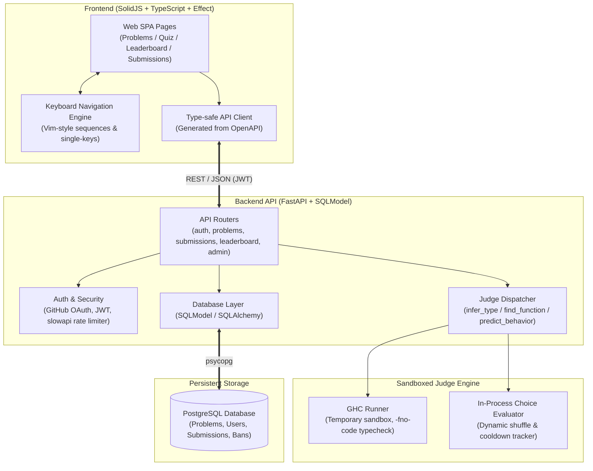

# MonadBeat

[](https://github.com/biyuehu/monadbeat/actions/workflows/ci.yml)
[](https://fastapi.tiangolo.com)
[](https://www.solidjs.com)
[](https://www.typescriptlang.org)
[](https://www.haskell.org/ghc/)
[](LICENSE)

A Haskell practice platform. Answer type-signature, implementation, and behavior questions; get judged by GHC; climb the leaderboard.

## Architecture



## Tech Stack

| Layer | Technologies |
| :--- | :--- |
| **Frontend** | [SolidJS](https://www.solidjs.com) 1.9+, [TypeScript](https://www.typescriptlang.org) 5.8+, [UnoCSS](https://unocss.dev), [Vite](https://vite.dev), [Effect-TS](https://effect.website) |
| **Backend API** | [FastAPI](https://fastapi.tiangolo.com) 0.115+, [SQLModel](https://sqlmodel.tiangolo.com), [Pydantic](https://docs.pydantic.dev) v2, [uv](https://astral.sh/uv), [psycopg3](https://www.psycopg.org) |
| **Judge Engine** | Sandboxed [GHC](https://www.haskell.org/ghc/) (`-fno-code` type checking, RTS memory & execution time bounds) |
| **Storage & Gateway** | [PostgreSQL](https://www.postgresql.org) 16, [Caddy](https://caddyserver.com) (Reverse proxy, HTTP/3, automatic HTTPS) |

## Documentation & Guides

- 🚀 **[Production Deployment Guide](docs/DEPLOYMENT.md)** — Step-by-step instructions for Docker Compose and standalone artifact (wheel + SPA bundle) deployments, systemd units, Nginx/Caddy configs, and security hardening.
- 📖 **[Problem Specification & Authoring Guide](docs/PROBLEM_GUIDE.md)** — Problem design principles, scaffold templates, bidirectional type coercion mechanics, and JSON schema specs.

## Deployment

MonadBeat supports two production deployment methods:

1. **Docker Compose (Recommended)**: Orchestrates PostgreSQL, the sandboxed GHC backend, and Caddy web server in isolated containers.
2. **Standalone Artifacts (Bare Metal / VPS)**: Deploy the backend Python wheel and pre-compiled frontend SPA bundle directly from GitHub Actions CI releases.

👉 For complete setup instructions and custom domain / HTTPS guidance, see the **[Production Deployment Guide](docs/DEPLOYMENT.md)**.

### Quick Start with Docker

```sh
# 1. Start all services in background
docker compose up -d --build

# 2. Seed initial problems into database
docker compose exec backend uv run python -m scripts.seed

# 3. View live logs
docker compose logs -f
```

The application is accessible at `http://localhost` (or your configured `PORT`).

### Environment Variables for Docker

Override in your `.env` file or environment:

- `PORT` — Host port exposed by Caddy (defaults to `80`)
- `POSTGRES_USER`, `POSTGRES_PASSWORD`, `POSTGRES_DB` — Database credentials
- `JWT_SECRET` — Secret key for signing auth tokens (minimum 32 characters)
- `GITHUB_CLIENT_ID`, `GITHUB_CLIENT_SECRET` — GitHub OAuth credentials (optional)

## Dev

Requires `uv` (backend) and `bun` (frontend).

```sh
just dev              # backend dev server (uvicorn --reload)
just lint             # ruff check --fix + format
just check            # pyright
just build-db         # create sqlmodel tables
just gen-types        # export openapi.json and regenerate src/lib/api-types.ts
```

```sh
bun run dev           # vite dev server (runs `just gen-types` first)
bun run build         # tsc -b && vite build (runs `just gen-types` first)
bunx biome check src  # lint
```

`openapi.json` and `src/lib/api-types.ts` are generated and git-ignored. Both `bun run dev` and `bun run build` regenerate them first; run `just gen-types` manually when you only want to refresh the types.

## Config

`.env` (see `.env.example`):

- `JWT_SECRET` — required, no default
- `DATABASE_URL` — postgresql+psycopg://...
- `GITHUB_CLIENT_ID`, `GITHUB_CLIENT_SECRET` — for OAuth
- `SITE_URL` — backend public URL, used for OAuth callback
- `FRONTEND_URL` — frontend origin(s), comma-separated, used for CORS and post-login redirects

Everything else in `app/config.py` has a working default and can be overridden the same way (`GHC_BINARY`, `GHC_TIMEOUT_SEC`, `GHC_MEMORY_MB`, `MAX_ANSWER_LENGTH`, `SUBMIT_RATE_LIMIT`, `LEADERBOARD_MAX_ENTRIES`, `JWT_ALGORITHM`, `JWT_EXPIRE_MINUTES`).

## Problem Types & Judge Engine

Rather than relying on generic string diffs, MonadBeat leverages GHC's real type checker:

- **`infer_type`** — Deduce the most general type signature for a given Haskell expression. The judge wraps your input and the reference signature in a bidirectional identity coercion (`id :: CorrectSig -> UserSig` and `UserSig -> CorrectSig`).
  > *Note*: Standalone signatures require explicit `forall` (e.g. `forall a. [a] -> Int`).
- **`find_function`** — Implement a function expression matching a target signature. Any mathematically sound Haskell expression is accepted; bottom values (`undefined`, `error`) are strictly prohibited.
- **`predict_behavior`** — Predict the runtime outcome (values, exceptions, or laziness traps) of expressions involving Weak Head Normal Form (WHNF), `seq`, or infinite data structures without compiler overhead.

👉 Read the **[Problem Authoring & Specification Guide](docs/PROBLEM_GUIDE.md)** for detailed problem creation rules, scaffold templates, and JSON schemas.
