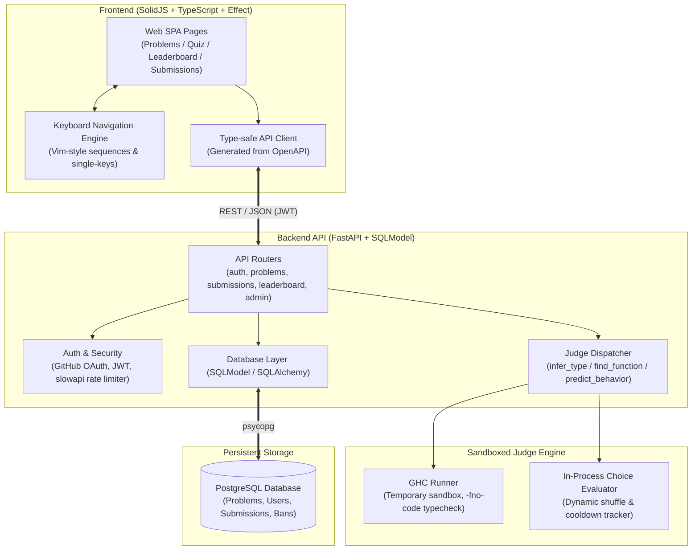

# MonadBeat

[](https://github.com/biyuehu/monadbeat/actions/workflows/ci.yml)
[](https://fastapi.tiangolo.com)
[](https://www.solidjs.com)
[](https://www.typescriptlang.org)
[](https://www.haskell.org/ghc/)
[](LICENSE)

A Haskell practice platform. Answer type-signature, implementation, and behavior questions; get judged by GHC; climb the leaderboard.

## Architecture



## Stack

## Dev

Requires `uv` (backend) and `bun` (frontend).

```sh
just dev              # backend dev server (uvicorn --reload)
just lint             # ruff check --fix + format
just check            # pyright
just build-db         # create sqlmodel tables
just gen-types        # export openapi.json and regenerate src/lib/api-types.ts
```

```sh
bun run dev           # vite dev server (runs `just gen-types` first)
bun run build         # tsc -b && vite build (runs `just gen-types` first)
bunx biome check src  # lint
```

`openapi.json` and `src/lib/api-types.ts` are generated and git-ignored. Both `bun run dev` and `bun run build` regenerate them first; run `just gen-types` manually when you only want to refresh the types.

## Config

`.env` (see `.env.example`):

- `JWT_SECRET` — required, no default
- `DATABASE_URL` — postgresql+psycopg://...
- `GITHUB_CLIENT_ID`, `GITHUB_CLIENT_SECRET` — for OAuth
- `SITE_URL` — backend public URL, used for OAuth callback
- `FRONTEND_URL` — frontend origin(s), comma-separated, used for CORS and post-login redirects

Everything else in `app/config.py` has a working default and can be overridden the same way (`GHC_BINARY`, `GHC_TIMEOUT_SEC`, `GHC_MEMORY_MB`, `MAX_ANSWER_LENGTH`, `SUBMIT_RATE_LIMIT`, `LEADERBOARD_MAX_ENTRIES`, `JWT_ALGORITHM`, `JWT_EXPIRE_MINUTES`).

## Judge

Three problem types are implemented:

- `infer_type` — user writes a type signature; GHC must accept the assembled file
- `find_function` — user writes a function body; GHC must type-check it
- `predict_behavior` — multiple choice, checked in-process

`SatisfyLawConfig` and `FixLazinessConfig` are commented out and not scored.
